# MediGest

Sistema de escritorio para la **gestión de turnos de un consultorio o clínica médica**. Permite administrar turnos, pacientes con su historial de consultas, médicos con su disponibilidad horaria, convenios con obras sociales y los usuarios del sistema. Cada usuario ve solo lo que corresponde a su rol: **Administrador**, **Médico** o **Recepcionista**.

Hecho en **Java (Swing)** con **Maven** y base de datos **MySQL / MariaDB**, pensado para correr con XAMPP.

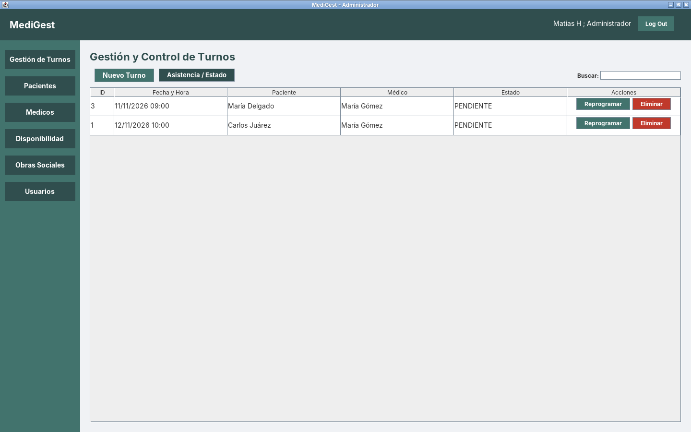

---

## Índice

- [Funcionalidades](#funcionalidades)
- [Roles y permisos](#roles-y-permisos)
- [Recorrido por la aplicación](#recorrido-por-la-aplicación)
- [Requisitos](#requisitos)
- [Instalación y ejecución](#instalación-y-ejecución)
- [Usuarios de prueba](#usuarios-de-prueba)
- [Estructura del proyecto](#estructura-del-proyecto)

---

## Funcionalidades

- **Inicio de sesión** con email y contraseña. Según el rol se abre una ventana distinta.
- **Gestión de turnos**: alta de turnos en intervalos de 30 minutos, reprogramación, cancelación/eliminación y registro de asistencia (`PENDIENTE`, `CONFIRMADO`, `ATENDIDO`, `AUSENTE`, `CANCELADO`). Incluye búsqueda en vivo sobre la tabla.
- **Pacientes e historial clínico**: listado de pacientes con DNI, teléfono y obra social. Al seleccionar uno se muestra el historial de sus consultas.
- **Médicos**: directorio con especialidad y estado. Al seleccionar uno se ven sus franjas horarias de atención.
- **Disponibilidad**: calendario mensual por médico que resalta los días en que atiende y permite agregar franjas horarias.
- **Obras sociales**: alta y baja de convenios con obras sociales y prepagas.
- **Usuarios**: alta y baja de usuarios del sistema con su rol.

### Validaciones de negocio

La capa de servicios controla las reglas antes de tocar la base de datos. Por ejemplo:

- No se puede dar un turno fuera del horario de atención del médico ni en un horario ya ocupado.
- No se puede reprogramar ni cancelar un turno ya **atendido**.
- Un turno cancelado tiene que reprogramarse para volver a estar activo.
- No se puede agendar con un médico dado de baja ni con un paciente no registrado.
- No se permiten obras sociales con nombre duplicado.

---

## Roles y permisos

| Sección            | Administrador | Recepcionista | Médico |
|--------------------|:-------------:|:-------------:|:------:|
| Turnos             | ✅ completo   | ✅ completo   | ✅ (Mi Agenda) |
| Pacientes          | ✅ alta / baja | ✅ alta / baja | 👁️ solo consulta |
| Médicos            | ✅ alta / baja | 👁️ solo consulta | — |
| Disponibilidad     | ✅            | ✅            | ✅     |
| Obras Sociales     | ✅            | —             | —      |
| Usuarios           | ✅            | —             | —      |

---

## Recorrido por la aplicación

> Las capturas son de la aplicación ejecutándose con los datos de ejemplo incluidos en `db/MG_DB_IMPORT.sql`.

### 1. Inicio de sesión

El usuario ingresa su email y contraseña. Si los datos son correctos, aparece un mensaje de bienvenida y se abre la ventana que corresponde a su rol.

<p>
  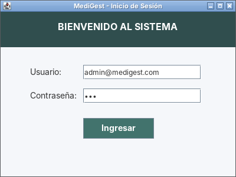
  &nbsp;
  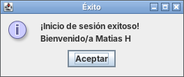
</p>

### 2. Gestión de turnos

Todas las ventanas comparten el mismo diseño: encabezado con el nombre del usuario y el botón **Log Out**, menú lateral de secciones y el contenido a la derecha.

La pantalla de turnos lista fecha y hora, paciente, médico y estado. Cada fila tiene botones para **Reprogramar** o **Eliminar**. El campo **Buscar** filtra la tabla mientras se escribe.


Con **Nuevo Turno** se abre el formulario para agendar. Se elige fecha, hora (en intervalos de 30 minutos), paciente, médico y motivo de la consulta.

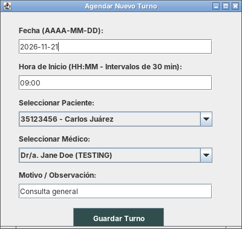

### 3. Pacientes e historial de consultas

Vista dividida: a la izquierda, el registro de pacientes; a la derecha, el historial de consultas del paciente seleccionado.


### 4. Médicos y sus horarios

Al seleccionar un médico se ven sus franjas de atención por día de la semana.

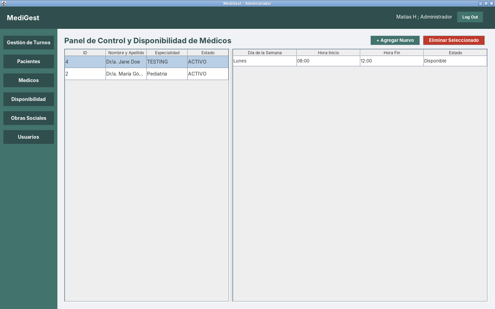

### 5. Calendario de disponibilidad

Calendario mensual por médico. Los días en que atiende aparecen resaltados y se puede navegar entre meses.

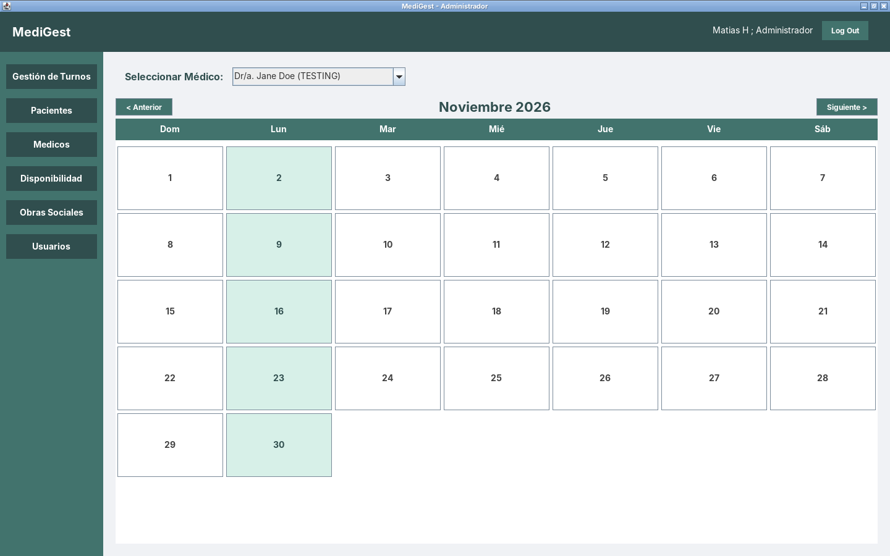

### 6. Obras sociales

Convenios con obras sociales y prepagas, con su código o plan y estado.

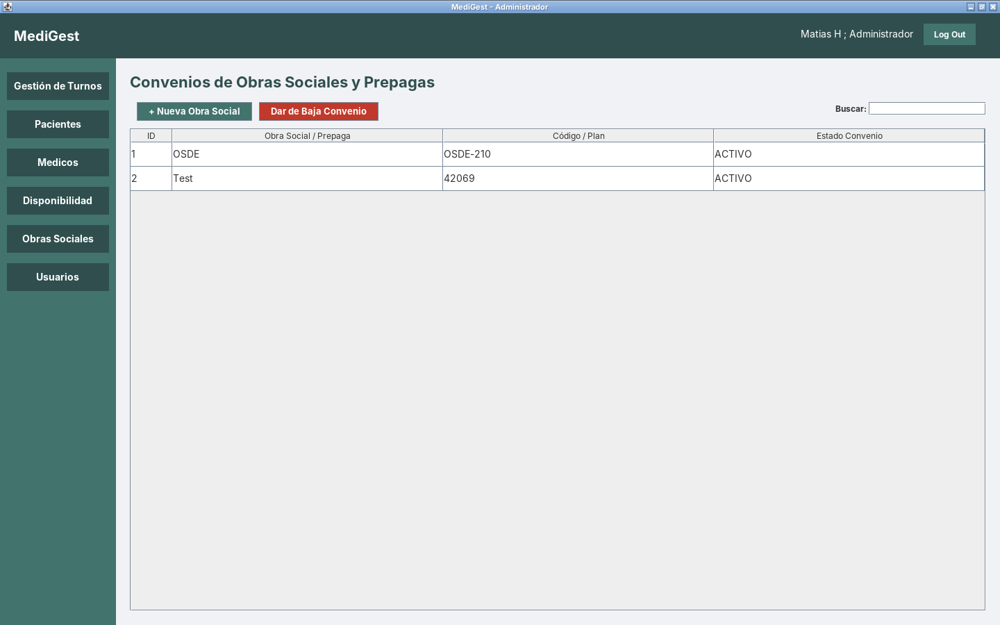

### 7. Usuarios del sistema (solo Administrador)

Listado de todos los usuarios con su rol, y formulario para registrar uno nuevo.

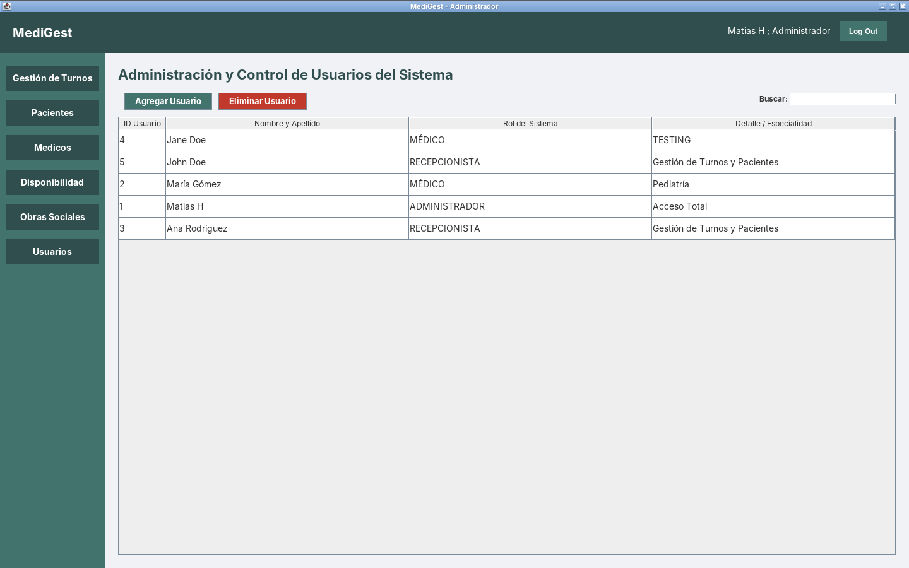

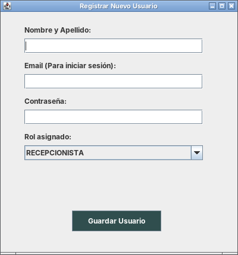

### 8. Vistas por rol

**Médico**: el menú se reduce a *Mi Agenda / Turnos*, *Pacientes* (solo consulta) y *Disponibilidad*.

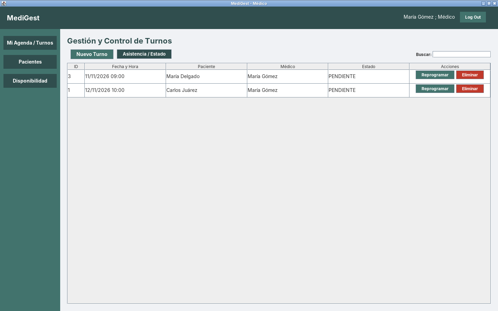

**Recepcionista**: puede gestionar turnos y pacientes, pero el directorio de médicos es de solo consulta (sin botones de alta y baja).

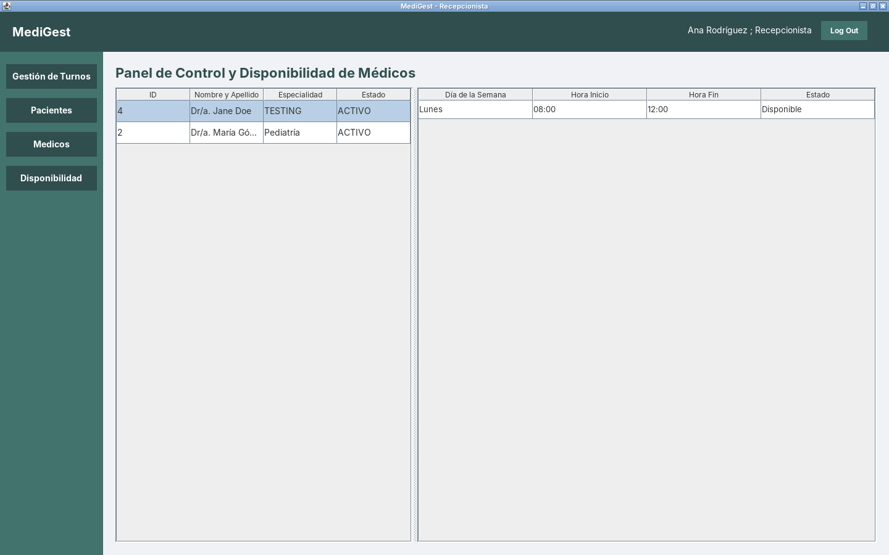

---

## Requisitos

- **JDK 25** (el `pom.xml` compila con `maven.compiler.release` 25)
- **Maven** (o un IDE como NetBeans / IntelliJ que lo integre)
- **MySQL o MariaDB**, por ejemplo con [XAMPP](https://www.apachefriends.org/)

## Instalación y ejecución

### 1. Base de datos

1. Iniciá MySQL desde el panel de XAMPP.
2. Creá una base de datos llamada `medigest` (por ejemplo desde phpMyAdmin):
   ```sql
   CREATE DATABASE medigest CHARACTER SET utf8mb4;
   ```
3. Importá el archivo [`db/MG_DB_IMPORT.sql`](db/MG_DB_IMPORT.sql) dentro de esa base (phpMyAdmin → *Importar*, o por consola):
   ```bash
   mysql -u root medigest < db/MG_DB_IMPORT.sql
   ```

La conexión está configurada en [`Conexion.java`](src/main/java/com/mycompany/medigest/DAO/Conexion.java) con la configuración por defecto de XAMPP:

| Parámetro  | Valor                                    |
|------------|------------------------------------------|
| URL        | `jdbc:mysql://localhost:3306/medigest`   |
| Usuario    | `root`                                   |
| Contraseña | *(vacía)*                                |

Si tu MySQL usa otro usuario o contraseña, cambialos en ese archivo.

### 2. Compilar y ejecutar

Desde el IDE, abrí el proyecto y ejecutá la clase principal `com.mycompany.medigest.MediGest`.

Desde la consola:

```bash
mvn clean package
mvn exec:java
```

Maven descarga automáticamente el driver `mysql-connector-j`.

## Usuarios de prueba

La base de ejemplo trae estos usuarios:

| Rol           | Email                    | Contraseña |
|---------------|--------------------------|------------|
| Administrador | `admin@medigest.com`     | `123`      |
| Médico        | `medico@medigest.com`    | `123`      |
| Recepcionista | `recepcion@medigest.com` | `123`      |

> ⚠️ Son datos de demostración: las contraseñas se guardan en texto plano. No usar en producción.

---

## Estructura del proyecto

El código está organizado en capas:

```
src/main/java/com/mycompany/medigest/
├── MediGest.java        # Punto de entrada: abre la ventana de login
├── entidades/           # Modelo de dominio: Usuario (Administrador, Medico, Recepcionista),
│                        #   Paciente, Turno, ObraSocial, Rol
├── DAO/                 # Acceso a datos con JDBC (BaseDAO, Conexion y un DAO por tabla)
├── servicios/           # Lógica y validaciones de negocio (TurnoService, PacienteService, ...)
└── interfaz/            # Ventanas y paneles Swing (LoginFrame, VentanaBase y una ventana por rol)
db/
└── MG_DB_IMPORT.sql     # Esquema y datos de ejemplo de la base "medigest"
docs/capturas/           # Capturas de pantalla usadas en este README
```

**Flujo:** la interfaz (`interfaz`) solo habla con los servicios (`servicios`). Los servicios validan las reglas de negocio y usan los DAO (`DAO`), que ejecutan el SQL y devuelven las entidades (`entidades`).

### Tablas de la base de datos

`usuario` · `medico` · `paciente` · `obra_social` · `turno` · `disponibilidad`
